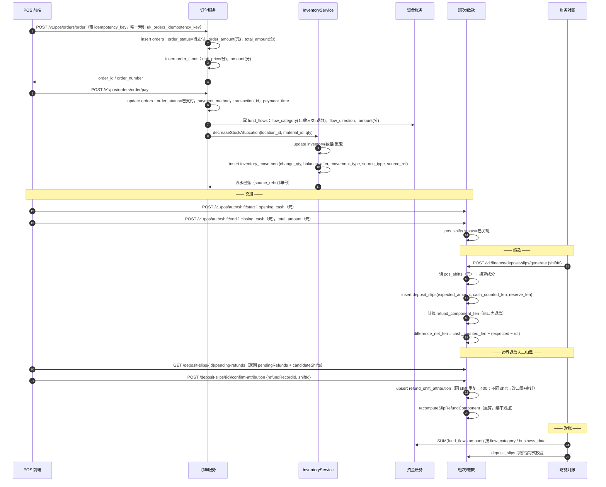
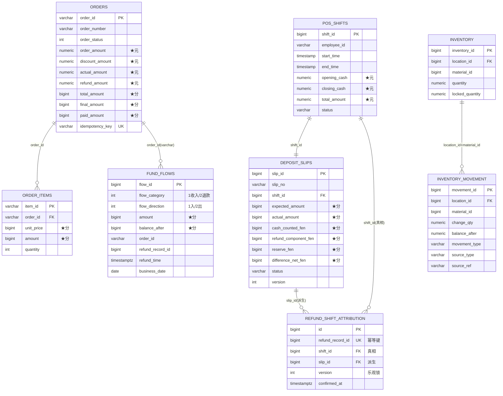

# 系统地图（System Map）

> 目标读者：新入职工程师 / 新开的 AI 会话。
> 读这一份就能知道：钱和货怎么流、谁有权写、单位是元还是分、怎么证明链路是通的。
> **本文只写经实测确认的事实**；标注「待确认」的地方就是还没验证。

素材来源（结论不重写，直接引用）：
- 退款归属契约与 as-of 口径：`docs/design/api-deposit-slip-attribution.md`
- 金额单位边界（元 vs 分）：`docs/audit/money-unit-boundary.md`
- 权限模型（含两种权限形态）：`docs/design/permission-model.md`
- 边界退款夹具（含快速回归基线）：`docs/audit/e2e-boundary-refund-fixtures.md`

---

## 0. 三分钟速览（先记住这 6 条）

1. **`orders` 表内部混用两种金额单位**：`order_amount/discount_amount/actual_amount/refund_amount` 是 numeric(元)，`total_amount/final_amount/paid_amount` 是 bigint(分)。漏换算 = 静默 100 倍误差，**不报错**。
2. **库存只能经 `InventoryService` 写**（`increaseStockAtLocation` / `decreaseStockAtLocation`）；绕过它直接写 `inventory` / `inventory_movement` 会**漏流水**，账与货从此对不上。
3. **`pos_shifts.opening_cash/closing_cash/total_amount` 是元**，而缴款单 `deposit_slips.*_fen` 是分 —— 交接处必须换算。
4. **缴款单净额恒等式**：`difference_net_fen = cash_counted_fen − (expected_amount − refund_component_fen)`（全部分）。这条是财务对账的锚。
5. **退款归属**（`refund_shift_attribution`）决定某笔退款算进哪个班次；**归属行以 `shift_id` 为准**，`slip_id` 是派生值。
6. **权限有两套形态**：`permissions.permission_id_str`（`PERM_*`，授权连接键）与 `permissions.permission_code`（`a:b:c`，Spring authority）。混用是历史脏数据的主因。

---

## 1. 核心业务时序（POS 点单 → 支付 → 扣库存 → 资金流水 → 交班交款 → 财务对账）



### 每个节点的真实字段（写代码前先看这张表）

| 环节 | 表 | 关键字段 | 单位 |
|------|----|----------|------|
| 下单 | `orders` | `order_id(varchar PK), order_number, order_status(int), idempotency_key` | — |
| 下单金额 | `orders` | `order_amount, actual_amount, discount_amount, refund_amount` | **元 numeric** |
| 下单金额 | `orders` | `total_amount, final_amount, paid_amount` | **分 bigint** |
| 明细 | `order_items` | `item_id(varchar PK), order_id(FK), unit_price, amount, quantity` | 分 |
| 资金 | `fund_flows` | `flow_category(1 收入/2 退款), flow_direction(1 入/2 出), amount, balance_after, order_id, refund_record_id` | **分** |
| 库存 | `inventory` | `inventory_id, location_id, material_id, 数量/锁定数量` | 数量 numeric |
| 库存流水 | `inventory_movement` | `movement_id, location_id, material_id, change_qty, balance_after, movement_type, source_type, source_ref` | 数量 |
| 班次 | `pos_shifts` | `shift_id, terminal_id, employee_id, start_time, end_time, status` | — |
| 班次金额 | `pos_shifts` | `opening_cash, closing_cash, total_amount` | **元 numeric** |
| 缴款单 | `deposit_slips` | `slip_id, slip_no, shift_id, status, business_date, version` | — |
| 缴款金额 | `deposit_slips` | `expected_amount, actual_amount, cash_counted_fen, refund_component_fen, reserve_fen, difference_net_fen` | **分 bigint** |
| 退款归属 | `refund_shift_attribution` | `refund_record_id(幂等键), shift_id(真相), slip_id(派生), version(乐观锁), operator_id, reason` | — |

> `fund_flows.refund_time` 是 **timestamptz**（`timestamp with time zone`），而全库其余时间列是 `timestamp` —— 历史遗留，见 `docs/audit/tech-debt-schema.md` P0-1。

---

## 2. 模块边界与「谁拥有写入权」

```text
com.foodtraceability
├── controller/pos/*            POS 收银（下单、支付、班次）
├── controller/finance/*        资金账务（缴款单、资金流水、发票、对账）
├── controller/*Inventory*      库存（入库、出库、盘点、调拨）
├── service/impl/InventoryServiceImpl      ★ 库存写入的唯一入口
├── service/finance/deposit/*              缴款单（含退款归属）
└── security/*                              权限（JWT + 服务端解析权限）
```

### 写权限归属（违反就是数据缺陷，不是风格问题）

| 数据 | 唯一合法写入路径 | 绕过会怎样 |
|------|------------------|------------|
| 库存数量 + 流水 | `InventoryService.increaseStockAtLocation` / `decreaseStockAtLocation` | 直接 `UPDATE inventory` → **`inventory_movement` 缺一条**，货账不符且无迹可查 |
| 资金流水 | 资金服务写 `fund_flows`（`flow_category` + `flow_direction` + `amount(分)` 三件套必须同时正确） | 只写金额不写方向 → 汇总时正负抵消，报表静默错 |
| 缴款金额 | `DepositSlipServiceImpl`（**重算**，不累加） | 手工 UPDATE `refund_component_fen` → 差异恒等式失效 |
| 退款归属 | `confirm-attribution`（同 shift 重复 → 400；不同 shift → 改归属 + 审计） | 直接 INSERT 第二行 → 同一退款挂两个班次（**串班次**） |
| 订单幂等 | `uk_orders_idempotency_key` + NESTED savepoint 重试 | 靠 SELECT-then-INSERT 判重 → 并发下必然重复单 |

### 跨模块关联字段（真实列名，别猜）

```text
orders.order_number  ─────────────►  order_items.order_id     （注意：orders 主键是 order_id(varchar)，业务号是 order_number）
orders.order_id      ─────────────►  fund_flows.order_id      （fund_flows.order_id 是 varchar）
pos_shifts.shift_id  ─────────────►  deposit_slips.shift_id   （一张班次一张缴款单）
pos_shifts.employee_id ───────────►  employees.employee_id    （字符串型员工号）
deposit_slips.slip_id ────────────►  refund_shift_attribution.slip_id（派生）
pos_shifts.shift_id  ─────────────►  refund_shift_attribution.shift_id（真相）
fund_flows.refund_record_id ──────►  refund_shift_attribution.refund_record_id（幂等键）
inventory.location_id ────────────►  locations.location_id
inventory.material_id ◄──────────►  inventory_movement.material_id
```

---

## 3. 核心表 ER 图（**金额单位必须看清**）



> ★ 标记的都是金额列。**同一张 `orders` 里同时存在元列与分列**，这是本系统最危险的一处设计债（最危险 5 条排序见 `docs/audit/money-unit-boundary.md`）。

---

## 4. 每条关键链路的「验证方法」（可直接跑的 SQL / 接口）

### 4.1 缴款单净额恒等式（财务对账锚点）

```sql
-- 期望：0
SELECT count(*) AS bad
  FROM deposit_slips
 WHERE deleted = 0
   AND difference_net_fen IS DISTINCT FROM (cash_counted_fen - (expected_amount - refund_component_fen));
```

### 4.2 退款归属是否串班次 / slip_id 是否同源

```sql
-- 期望：0 行（同一 refund 只允许一行归属）
SELECT refund_record_id, count(*) AS rows
  FROM refund_shift_attribution GROUP BY refund_record_id HAVING count(*) > 1;

-- 期望：0 行（slip_id 必须与 shift_id 同源）
SELECT a.id, a.refund_record_id, a.shift_id, a.slip_id, s.slip_id AS expected_slip
  FROM refund_shift_attribution a
  JOIN deposit_slips s ON s.shift_id = a.shift_id
 WHERE a.slip_id IS DISTINCT FROM s.slip_id;
```

### 4.3 退款是否被重复计入（重算 vs 累加）

```sql
-- 期望：0 行（人工归属的退款之和 == 缴款单 rcf）
SELECT s.slip_id, s.refund_component_fen, COALESCE(SUM(f.amount), 0) AS attributed_sum
  FROM deposit_slips s
  LEFT JOIN refund_shift_attribution a ON a.shift_id = s.shift_id
  LEFT JOIN fund_flows f ON f.refund_record_id = a.refund_record_id AND f.flow_category = 2
 WHERE s.deleted = 0
 GROUP BY s.slip_id, s.refund_component_fen
HAVING s.refund_component_fen IS DISTINCT FROM COALESCE(SUM(f.amount), 0);
```

### 4.4 库存流水是否连续（绕过 Service 写表的痕迹）

```sql
-- 期望：0 行。库存当前数量 == 该 (location, material) 最后一条流水的 balance_after
SELECT i.inventory_id, i.quantity, m.balance_after
  FROM inventory i
  JOIN LATERAL (
        SELECT balance_after FROM inventory_movement mm
         WHERE mm.location_id = i.location_id AND mm.material_id = i.material_id
         ORDER BY mm.movement_id DESC LIMIT 1) m ON true
 WHERE i.quantity IS DISTINCT FROM m.balance_after;
```

### 4.5 资金流水方向与类别自洽

```sql
-- 期望：0 行（收入=入账方向 1，退款=出账方向 2）
SELECT flow_id, flow_category, flow_direction, amount FROM fund_flows
 WHERE (flow_category = 1 AND flow_direction <> 1)
    OR (flow_category = 2 AND flow_direction <> 2);
```

### 4.6 元/分混用体检（**最容易静默错的一类**）

> ⚠ **2026-10-28 修正**：`orders.order_amount / actual_amount` 是**遗留列**——当前写路径用的实体是
> `OrderNew`（`@TableName("orders")`），它**没有** `orderAmount/actualAmount` 字段，所以这两列恒为 0
> （实测 48/48 行 = 0.00），而 `total_amount/final_amount` 有值。
> 因此下面这条「元×100 == 分」的断言**两边都是 0 时永远通过（假绿）**，必须加 `order_amount <> 0` 过滤；
> 真正的元/分一致性要**从明细反推**（第二条 SQL）。

```sql
-- ① 只对「元列确实有值」的订单做等值校验（否则是假绿）
SELECT order_id, order_amount, total_amount FROM orders
 WHERE deleted = 0 AND order_amount <> 0
   AND total_amount IS DISTINCT FROM (order_amount * 100)::bigint;

-- ② 真正的锚：订单总分 == 明细合计（两者都是分）
SELECT o.order_id, o.total_amount, COALESCE(SUM(i.amount), 0) AS items_sum
  FROM orders o LEFT JOIN order_items i ON i.order_id = o.order_number AND i.deleted = 0
 WHERE o.deleted = 0
 GROUP BY o.order_id, o.total_amount
HAVING o.total_amount IS DISTINCT FROM COALESCE(SUM(i.amount), 0);
```

### 4.7 `*_fen` 影子列（当前未启用）

```bash
python scripts/qa/fen_shadow_check.py     # 期望 EXIT=0：所有 *_fen 列均 NULL
```

若某列非空 > 0 → 有人开始写了，**必须先确认双写已上线**（`docs/audit/tech-debt-schema.md` P1-1）。

### 4.8 权限与迁移链路

```bash
python scripts/qa/preflight.py                 # A44/A45/A46 巡检（权限码形态、目录覆盖）
python scripts/qa/migration_version_gate.py    # EXIT=2：迁移版本号重复即阻断
```

### 4.9 端到端（现金对账）

```bash
python scripts/qa/e2e_cash_recon.py                       # 全量，~16 分钟（等班次越界）
python scripts/qa/e2e_cash_recon.py --skip-boundary-wait  # 快速：预期 PASS=52 / FAIL=2
```

**快速模式 52/2 是正常基线**，两条 FAIL 都是跳过设计内等待的直接后果（见 `docs/audit/e2e-boundary-refund-fixtures.md`）。

---

## 5. 权限模型要点（新人最常踩）

- **两套形态并存**：`permissions.permission_id_str`（`PERM_*`，与 `role_permissions.permission_id` 连接）与 `permissions.permission_code`（`a:b:c`，Spring `hasAuthority` 用）。
- **JWT 只装身份**：token 里只有 `userId` + `roleIds`（另有 **`locationId` 条件写入**：`JwtUtils.java:168-169` 仅当用户分配了归属位置时才 `claims.put("locationId", ...)`，未分配则无该 claim —— 读 token 时必须判空，不能假设恒存在）；权限**服务端解析**（`UserPermissionCache`，45s TTL + 每秒版本比对主动失效），撤权实测 **1.1s** 生效。
- **admin 的 `'*'`**：`SecurityUser:73` 仅给 admin 硬加 `SimpleGrantedAuthority("*")`；目录里**不存在** `permission_code='*'`。历史 532 处是「具体码 or `'*'`」，真正 star-only 只有 **2 处**。
- **改授权数据铁律**：授权行**永远不用 `DELETE`**，只用 `deleted=1`；去重前必须确认「另一条同权限授权是 `deleted=0`」（`deleted=1` 不算数）。

---

## 6. 新人第一天该跑的 5 条命令

```bash
python scripts/qa/preflight.py --full        # clean → test-compile → mvn test → from-zero gate
python scripts/qa/migration_version_gate.py  # 迁移版本唯一性（EXIT=2 阻断）
python scripts/qa/fen_shadow_check.py        # *_fen 影子列应为全 NULL
python scripts/qa/e2e_cash_recon.py --skip-boundary-wait   # 预期 52 PASS / 2 FAIL
python scripts/qa/entity_column_audit.py     # 实体列 ↔ 表列一致性（已知遗留 137 处）
```

---

## 7. 这份地图的边界（哪些还没验证）

| 项 | 状态 |
|----|------|
| 时序图「支付 → 扣库存」的调用顺序 | 依据 `PosOrderCreateServiceImpl` / `InventoryDeductionServiceImpl` 代码路径整理，**未逐行插桩验证** |
| `inventory` 表名 | 实体 `@TableName("inventory")` 已核，物理表存在 |
| 45 张部署缺口逐张归属 | 仅分三档估算，未逐张裁定（见 `docs/audit/missing-tables-delta.md`） |
| 权限矩阵「谁该有哪个码」 | 需产品给权限矩阵；当前以 `permissions` 目录为准 |
